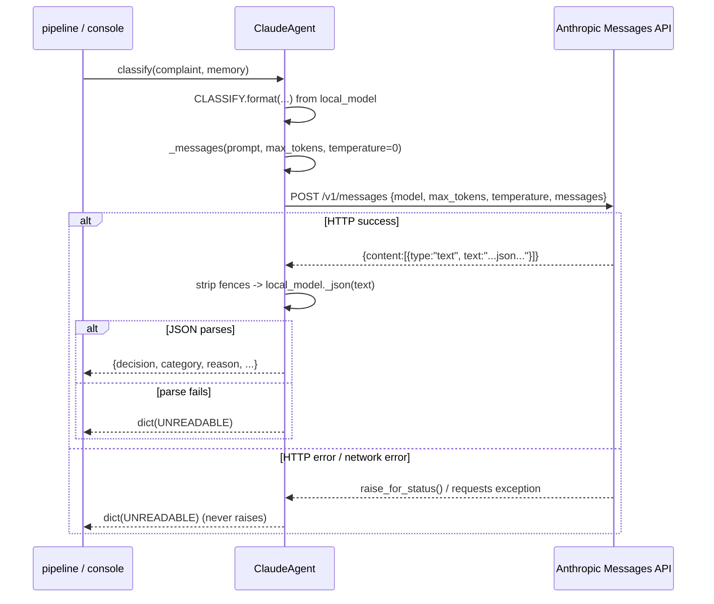

# Design Document

## Overview

This feature adds a built-in **Claude agent** plugin to Thirty. It is a second cloud-free-by-default
architecture member that, unlike every other agent, intentionally sends complaint text to a cloud model
(Anthropic's Claude). It implements the existing `Agent` interface — `classify`, `draft_report`,
`follow_up_questions`, `health` — by calling the Anthropic Messages API directly over HTTP with
`requests`, with no Anthropic SDK dependency.

The design is built on one reuse decision: the Claude agent **imports the local-model agent's prompt
templates and JSON parser** rather than duplicating them. `thirty/agents/local_model.py` already defines
`CLASSIFY`, `MDR_FIELDS`, `ASK`, the `_json()` brace-extraction parser and `deadline_text()`. Reusing
them keeps Claude's decisions directly comparable with the local model's and means prompt changes stay in
one place.

Three things change in the codebase:

1. A new module `thirty/agents/claude_model.py` with a `ClaudeAgent(Agent)` class.
2. A new built-in plugin package `thirty/plugins/builtin/claude/` (`plugin.json` + `plugin.py`), mirroring
   the existing `local` plugin so the Plugin_System discovers, validates, configures and health-checks it
   with no changes to `thirty/plugins/__init__.py`.
3. A cloud-badge swap driven by a new template context variable computed in `dashboard_v2/app.py`, applied
   in `base.html` and `setup.html`, so the "0 bytes to cloud AI" badge is replaced by
   "Cloud model (demo, sample data)" only while the Claude agent is active.

This is a Hackachusetts demo feature that operates on invented sample data only.

### Research notes

- **Anthropic Messages API contract.** Requests are `POST https://api.anthropic.com/v1/messages` with
  headers `x-api-key` (the key) and `anthropic-version` (a dated version string such as `2023-06-01`), and
  a JSON body `{model, max_tokens, temperature, messages:[{role, content}]}`. A successful response has a
  top-level `content` list of blocks; a text block is `{"type": "text", "text": "..."}`, so the model
  output is `content[0]["text"]`. Error statuses (401 bad key, 400 bad request, 429 rate limit, 5xx) are
  surfaced by `response.raise_for_status()`. Source: Anthropic Messages API reference
  (https://docs.anthropic.com/en/api/messages). Content was rephrased for compliance with licensing
  restrictions.
- **Code-fence wrapping.** Chat models frequently wrap JSON answers in Markdown code fences
  (```` ```json ... ``` ````). The local model's `_json()` already tolerates leading/trailing prose via a
  regex that grabs the first `{...}` span, but a fence can interleave with braces in edge cases, so the
  Claude JSON helper strips fences first, then delegates to `local_model._json`.
- **Plugin contract (confirmed by reading `thirty/plugins/__init__.py`).** `_validate()` requires the
  manifest `id` to match the folder name and `capabilities` to include `agent`. `SETTING_TYPES` includes
  `secret`, `string` and `number`. `status()` returns `not-configured` from `Plugin.missing()` — which
  only flags settings marked `required` — otherwise it calls the agent's `health()`. Therefore `api_key`
  must **not** be `required` in the manifest (it falls back to env `ANTHROPIC_API_KEY`); a missing key is
  surfaced at `health()`/call time instead, which `status()` reports as `error`.
- **Template wiring (confirmed by reading `dashboard_v2/app.py`).** The `@app.context_processor`
  `_globals()` (around line 708) injects `AGENT`, `LOCAL_AGENT`, `DEMO_MODE` etc. The badge swap adds one
  more key computed from the active agent id. `tests/test_console.py::test_pages_render_as_thirty` asserts
  `"0 bytes to cloud AI"` is present on every page under the default sample agent, so the default case
  must keep rendering the original badge.
- **Hypothesis is not yet a dependency.** `pyproject.toml` `dev` extra lists only `pytest` and
  `playwright`; `requirements-dev.txt` lists `pytest` and `playwright`. The design adds `hypothesis` to the
  dev/test dependencies.

## Architecture

```mermaid
flowchart TD
    subgraph Console["dashboard_v2 (Flask console)"]
        CP["_globals() context processor\ncomputes CLOUD_AGENT from active agent id"]
        BH["base.html sidebar badge"]
        SU["setup.html footer + list badge"]
        CP --> BH
        CP --> SU
    end

    subgraph Plugins["thirty/plugins"]
        REG["discover / validate / status / instantiate\n(unchanged)"]
        PKG["builtin/claude/\nplugin.json + plugin.py"]
        REG --> PKG
    end

    subgraph Agents["thirty/agents"]
        BASE["base.Agent + UNREADABLE"]
        LM["local_model.py\nCLASSIFY / MDR_FIELDS / ASK / _json / deadline_text"]
        CA["claude_model.ClaudeAgent"]
        BASE --> CA
        LM -. imports prompts & parser .-> CA
    end

    PKG -->|create(settings)| CA
    REG -->|instantiate -> health()| CA
    CP -->|active_agent_id()| REG
    CA -->|HTTPS POST| ANT["Anthropic Messages API\napi.anthropic.com/v1/messages"]
```

### Request/response flow for one agent call



### Error-handling layering (one rule per layer)

| Layer | Responsibility | On failure |
| --- | --- | --- |
| `_messages()` | HTTP transport: build request, apply timeout, `raise_for_status`, extract `content[0].text` | **Raises** (requirement 6) |
| `classify` / `draft_report` / `follow_up_questions` | Build prompt, call `_messages`, parse JSON | **Catch and fall back** to the documented fallback; never raise (requirements 3/4/5) |
| `health` | One tiny call, timed | **Catch** and return `{ok: False, label: ...}`; never raises (requirement 7) |

This layering keeps the raise/fallback contract explicit: transport raises, the three pipeline methods
swallow, health reports.

## Components and Interfaces

### 1. `thirty/agents/claude_model.py`

A compact module in the style of `local_model.py` (module-level constants, a few free functions, one
class with short methods and docstrings).

```python
"""Claude agent: the local model's prompts and JSON parsing, sent to Anthropic's cloud model.

Calls the Anthropic Messages API directly over HTTP (no SDK). Reuses local_model's CLASSIFY, MDR_FIELDS,
ASK prompts and _json parser so decisions stay comparable with the local model agent. Unlike every other
agent, this one sends complaint text to a cloud model, so the console swaps its "0 bytes to cloud AI"
badge while it is active. Demo feature: invented sample data only.
"""
import json, os, re, time
import requests

from .base import Agent, UNREADABLE
from . import local_model as lm

API_URL = "https://api.anthropic.com/v1/messages"
ANTHROPIC_VERSION = "2023-06-01"
DEFAULT_MODEL = "claude-sonnet-5-5"


def resolve_key(api_key):
    """The setting value if it has a non-whitespace character, else env ANTHROPIC_API_KEY, else ""."""
    if api_key and api_key.strip():
        return api_key.strip()
    return (os.environ.get("ANTHROPIC_API_KEY") or "").strip()


def _extract_json(text):
    """Strip Markdown code fences, then reuse local_model._json (first {...} span)."""
    cleaned = re.sub(r"```[a-zA-Z]*\n?|```", "", text or "")
    return lm._json(cleaned)


class ClaudeAgent(Agent):
    id = "claude"
    name = "Claude agent"

    def __init__(self, api_key="", model="", timeout=60):
        self.api_key = api_key or ""
        self.model = model or DEFAULT_MODEL
        self.timeout = float(timeout or 60)

    def _messages(self, prompt, max_tokens, temperature=0.1):
        key = resolve_key(self.api_key)
        if not key:
            raise RuntimeError("No Anthropic API key: set the api_key setting or ANTHROPIC_API_KEY.")
        r = requests.post(API_URL, timeout=self.timeout, headers={
            "x-api-key": key, "anthropic-version": ANTHROPIC_VERSION, "content-type": "application/json",
        }, json={"model": self.model, "max_tokens": max_tokens, "temperature": temperature,
                 "messages": [{"role": "user", "content": prompt}]})
        r.raise_for_status()
        content = r.json().get("content") or []
        return (content[0].get("text") if content else "") or ""

    def classify(self, complaint, memory=""):
        try:
            prompt = lm.CLASSIFY.format(memory=memory or "No prior complaints on this device family.", **complaint)
            return _extract_json(self._messages(prompt, 400, temperature=0))
        except Exception:
            return dict(UNREADABLE)

    def draft_report(self, complaint, row):
        try:
            prompt = lm.MDR_FIELDS.format(decision=row["decision"], category=row["category"],
                                          deadline=lm.deadline_text(row.get("deadline_days")),
                                          missing=row["missing"] or "none listed",
                                          **{"generic_name": "", "product_code": "", "manufacturer": "",
                                             "manufacturer_narrative": "none", **complaint})
            return _extract_json(self._messages(prompt, 1500))
        except Exception:
            return {"H10_manufacturer_narrative": "Model output unreadable - complete all fields manually."}

    def follow_up_questions(self, row, missing):
        try:
            prompt = lm.ASK.format(id=row["id"], decision=row["decision"], category=row["category"],
                                   device=row["device"], text=row.get("text") or "",
                                   missing="; ".join(missing) or "none listed")
            j = _extract_json(self._messages(prompt, 700, temperature=0.2))
            qs = [str(q).strip() for q in j.get("questions") or [] if str(q).strip()][:5]
            return qs, str(j.get("message") or "").strip()
        except Exception:
            return [], ""

    def health(self):
        try:
            t0 = time.perf_counter()
            self._messages("ping", 1, temperature=0)
            ms = round((time.perf_counter() - t0) * 1000)
            return {"ok": True, "name": self.model, "ms": ms, "label": f"{self.model} · {ms} ms"}
        except Exception as e:
            return {"ok": False, "name": self.name, "ms": None, "label": f"offline ({type(e).__name__})"}
```

Notes on fidelity to the existing code:

- The `classify`/`draft_report`/`follow_up_questions` prompt-building arguments are copied verbatim from
  `LocalModelAgent` so the two agents send the same text. The only differences are the HTTP layer
  (`_messages` instead of `llm`) and the fence-stripping wrapper around `_json`.
- `classify` uses `temperature=0` (requirement 3.2); `follow_up_questions` uses `0.2` and
  `draft_report` the default `0.1`, matching the local agent.
- `_messages` is the single raise point (requirement 6). The three methods wrap `_messages` + parse in
  `try/except Exception` and return the documented fallback; `health` wraps its own call.

### 2. `thirty/plugins/builtin/claude/plugin.json`

```json
{
  "id": "claude",
  "name": "Claude agent",
  "version": "1.0.0",
  "description": "Classifies complaints and drafts the Form 3500A with Anthropic's Claude via the Messages API. Demo feature: sends complaint text to a cloud model, so it runs on invented sample data only.",
  "capabilities": ["agent"],
  "settings": [
    {"key": "api_key", "label": "Anthropic API key", "type": "secret", "default": "",
     "help": "Falls back to the ANTHROPIC_API_KEY environment variable when left blank."},
    {"key": "model", "label": "Model", "type": "string", "default": "claude-sonnet-5-5",
     "help": "Anthropic model id."},
    {"key": "timeout", "label": "Timeout (seconds)", "type": "number", "default": 60}
  ]
}
```

- `id` equals the folder name `claude` so `_validate()` accepts it (requirement 1.2).
- `api_key` is **not** `required`, so `Plugin.missing()` returns `[]` and `status()` falls through to the
  health check rather than forcing `not-configured` (requirement 8, and the env-fallback design note).

### 3. `thirty/plugins/builtin/claude/plugin.py`

```python
"""Built-in plugin: the Claude agent (Anthropic Messages API)."""
from thirty.agents.claude_model import ClaudeAgent


def create(settings):
    return ClaudeAgent(api_key=settings.get("api_key") or "", model=settings.get("model") or "",
                       timeout=float(settings.get("timeout") or 60))
```

Mirrors `local/plugin.py`. The Plugin_System merges manifest defaults before calling `create`, so
`model` defaults to `claude-sonnet-5-5` and `timeout` to `60`.

### 4. Console badge swap — `dashboard_v2/app.py`

Add one computed key to the `_globals()` context processor. The badge is "cloud" when the active agent id
is `claude`:

```python
# inside _globals(), alongside AGENT / LOCAL_AGENT
"CLOUD_AGENT": tconfig.agent_id() == "claude",
```

`tconfig.agent_id()` is the single source of truth already used by `LOCAL_AGENT` and `AGENT`, so the badge
updates on the next render whenever the active agent changes (requirement 9.5). When no agent is resolvable
the id is not `claude`, so the default `"0 bytes to cloud AI"` is rendered (requirement 9.6).

### 5. Templates

`base.html` sidebar (the `div.cloud0`):

```html
<div class="cloud0"><span class="badge-local">{{ "Cloud model (demo, sample data)" if CLOUD_AGENT else "0 bytes to cloud AI" }}</span></div>
```

`setup.html` footer badge:

```html
<span class="badge-local">{{ "Cloud model (demo, sample data)" if CLOUD_AGENT else "0 bytes to cloud AI" }}</span>
```

`setup.html` "what happens on this machine" list item uses the same guard so the two surfaces match
(requirement 9.4):

```html
<li>{{ "Cloud model (demo). Complaint text leaves this machine." if CLOUD_AGENT else "The agent runs locally. 0 bytes to cloud AI." }}</li>
```

Because the default agent is the sample agent (id `sample`, not `claude`), `CLOUD_AGENT` is false by
default and all pages keep rendering `"0 bytes to cloud AI"`, so
`test_console.py::test_pages_render_as_thirty` keeps passing (requirement 9.3, 11.5).

## Data Models

The Claude agent returns the exact shapes documented in `thirty/agents/base.py`. It introduces no new
persistent data — it is a stateless HTTP client.

### classify(complaint, memory) → dict

```python
{
  "decision": "REPORTABLE" | "NOT_REPORTABLE" | "NEEDS_INFO",
  "category": "DEATH" | "SERIOUS_INJURY" | "MALFUNCTION" | "NONE",
  "reason": str,
  "remedial_action_needed": bool,
  "missing_info": [str, ...],
  "confidence": int,   # 0-100
}
```

Fallback (unparseable / HTTP error / network error): a copy of `UNREADABLE`:

```python
{"decision": "NEEDS_INFO", "category": "NONE",
 "reason": "model output unreadable - human review",
 "deadline_days": 30, "missing_info": [], "confidence": 0}
```

### draft_report(complaint, row) → dict (Form_3500A_Fields)

On success, the JSON object from the model (A1–H10 fields as documented in `base.py` / the `MDR_FIELDS`
prompt). Fallback: `{"H10_manufacturer_narrative": "Model output unreadable - complete all fields manually."}`.

### follow_up_questions(row, missing) → (list[str], str)

A tuple: up to 5 question strings (first 5 kept, rest discarded), and a message string. Fallback: `([], "")`.

### health() → dict

Success: `{"ok": True, "name": <model>, "ms": <int>, "label": "<model> · <ms> ms"}`.
Error: `{"ok": False, "name": "Claude agent", "ms": None, "label": "offline (<ErrorType>)"}`.

### Anthropic Messages API request/response (external)

Request body: `{"model": str, "max_tokens": int, "temperature": number, "messages": [{"role": "user", "content": str}]}`
with headers `x-api-key` and `anthropic-version`. Success response (relevant slice):
`{"content": [{"type": "text", "text": "<model output>"}]}` — read `content[0]["text"]`.

## Correctness Properties

*A property is a characteristic or behavior that should hold true across all valid executions of a system —
essentially, a formal statement about what the system should do. Properties serve as the bridge between
human-readable specifications and machine-verifiable correctness guarantees.*

The Claude agent's core value is that it is a **pure wrapper over an untrusted text channel**: whatever the
network returns, the three pipeline methods must return a well-shaped result and never raise, and the
fallbacks must be exact. That is a universal statement over all possible response strings — a good fit for
property-based testing with Hypothesis. (The badge swap and the happy-path shapes are example/parametrized
tests, not properties; see Testing Strategy.)

### Property 1: Response-robustness (shape stability, no raises)

*For any* string returned by the mocked Anthropic API as the model output (arbitrary text, including empty,
non-JSON prose, truncated JSON, JSON missing keys, JSON wrapped in code fences, and very large inputs),
`classify()` returns a `dict`, `draft_report()` returns a `dict`, and `follow_up_questions()` returns a
`(list, str)` tuple, and none of the three raises.

**Validates: Requirements 3.3, 3.4, 4.2, 4.3, 5.2, 5.4**

### Property 2: Fallback determinism on unparseable output

*For any* model output that does not contain parseable JSON, `classify()` returns exactly the `UNREADABLE`
shape (same keys and values as a copy of `UNREADABLE`), `draft_report()` returns a dict containing an
`H10_manufacturer_narrative` key, and `follow_up_questions()` returns exactly `([], "")`.

**Validates: Requirements 3.4, 4.3, 5.4**

### Property 3: Question-count bound

*For any* parseable JSON response whose `questions` field is a list of any length, `follow_up_questions()`
returns at most 5 questions, preserving the first 5 in their original order.

**Validates: Requirements 5.2, 5.3**

### Property 4: Classification determinism via temperature 0

*For any* complaint and memory input, every request `classify()` sends to the Anthropic API carries
`temperature == 0` in its JSON body, so identical inputs produce an identical request (and thus an
identical decision and deadline under a deterministic backend).

**Validates: Requirements 3.1, 3.2**

### Property 5: Request-contract invariants

*For any* agent method that calls the API, the captured request is an HTTP POST to
`https://api.anthropic.com/v1/messages`, carries non-empty `x-api-key` and `anthropic-version` headers,
and sends a body whose `messages` list has exactly one entry with role `user` and content equal to the
prompt text.

**Validates: Requirements 6.1, 6.2, 6.3, 6.4**

### Reflection on property redundancy

- An early draft had a separate property "classify returns one of the three decision values on success".
  That overlaps Property 1 (shape) and is already exercised by the happy-path example tests, so it is
  folded into Property 1 / the example tests rather than kept as its own property.
- "Fallback on HTTP error" and "fallback on network error" were initially two properties; both reduce to
  "the method did not raise and returned the fallback", which Properties 1 and 2 already cover over all
  response states (a raising transport is just another way the `try` body fails), so they are merged.
- Requirement 2 (key resolution: setting over env, env fallback, header value) and Requirement 7 (health
  success/error) are example-based: they test specific, enumerable branches rather than a "for all inputs"
  statement, so they are not written as properties. They are covered in the Testing Strategy as example
  tests.

## Error Handling

- **No API key.** `resolve_key()` returns `""` when neither the setting nor `ANTHROPIC_API_KEY` is set.
  `_messages()` raises `RuntimeError` in that case. For the three pipeline methods this surfaces as the
  normal fallback (they catch everything); for `health()` it becomes `{ok: False, label: "offline (RuntimeError)"}`,
  which `plugins.status()` reports as `error` with that label (requirement 8.4). Because `api_key` is not
  `required`, `status()` does not short-circuit to `not-configured` — the missing key is surfaced through
  health, as intended.
- **HTTP error status** (401/400/429/5xx). `raise_for_status()` raises inside `_messages()` (requirement
  6.6). The three pipeline methods catch it and return their fallbacks (requirements 3.5, 4.4); `health()`
  catches it and returns `ok: False`.
- **Network / timeout errors.** `requests` raises (`ConnectionError`, `Timeout`, etc.) inside
  `_messages()`; handled identically to HTTP errors by the callers.
- **Unparseable or malformed success body.** `_extract_json()` raises (`json.JSONDecodeError` /
  `AttributeError` when no `{...}` span is found); callers return the parse-failure fallback (UNREADABLE /
  H10 stub / empty tuple). An empty or missing `content` list yields `""`, which also fails to parse and
  takes the same fallback path.
- **A broken plugin never stops the pipeline.** `thirty/agents/__init__.get_agent()` already falls back to
  `NoAgent` if `instantiate()` raises; no change needed.

## Testing Strategy

### Dual approach

- **Property-based tests (Hypothesis):** the robustness and fallback invariants (Properties 1–5), which
  must hold across the entire space of possible response strings and question-list lengths.
- **Example-based tests (pytest):** happy-path result shapes, key resolution branches, health
  success/error, and the badge swap — specific, enumerable cases that do not benefit from randomized input.

All HTTP is mocked. Tests monkeypatch `requests.post` (or `ClaudeAgent._messages`) so **no outbound request
reaches the Anthropic API** (requirement 11.1). A small helper builds a fake `requests.Response`-like object
whose `.json()` returns `{"content": [{"type": "text", "text": <supplied text>}]}` and whose
`raise_for_status()` optionally raises, and captures the `json=`/`headers=` kwargs for request-contract
assertions.

### PBT applicability

PBT **is** appropriate here: the three pipeline methods are effectively pure transforms from a response
string to a well-shaped result, with a large/infinite input space (arbitrary model text) and clear
universal invariants (never raise, exact fallbacks, ≤5 questions). It is **not** used for the badge swap
(a two-branch template decision) or key resolution (enumerable branches) — those are example/parametrized
tests.

### Property test configuration

- Library: **Hypothesis**. It is not currently a dependency; add `hypothesis>=6` to the dev/test
  dependencies (`pyproject.toml` `[project.optional-dependencies] dev` and `requirements-dev.txt`).
- Each property test runs **at least 100 iterations** (Hypothesis default `max_examples` is 100; set
  explicitly with `@settings(max_examples=100)` where a higher bound is cheap).
- Each property test is tagged with a comment referencing its design property, format:
  **Feature: claude-agent-plugin, Property {number}: {property_text}**.
- Each correctness property is implemented by a **single** property-based test.
- Strategies: `st.text()` for arbitrary model output (Property 1); a strategy mixing `st.text()` with
  generated non-JSON and fence-wrapped blobs for Property 2; `st.lists(st.text())` of arbitrary length for
  the `questions` field (Property 3); generated complaint/memory dicts for Property 4; any valid JSON body
  for Property 5.

### Example tests (pytest)

- **Happy paths:** mocked valid JSON → `classify` returns the documented classification dict, `draft_report`
  returns the Form_3500A_Fields dict, `follow_up_questions` returns a `(list[str], str)` tuple with the
  expected values (requirement 11.2). Include a fence-wrapped valid-JSON case to exercise `_extract_json`.
- **Key resolution (requirement 2):** setting value takes precedence over env; blank setting falls back to
  `ANTHROPIC_API_KEY`; the resolved key is sent as the `x-api-key` header; no key anywhere → `_messages`
  raises and the pipeline methods fall back.
- **Health (requirement 7, 11.4):** mocked success → `{ok: True, name, ms (int), label}` with
  `max_tokens == 1` in the captured body; mocked raise → `{ok: False, label}` and no exception escapes.
- **Plugin discovery/status (requirements 1, 8):** `plugins.discover()` lists `claude` with capability
  `agent` and no manifest error; `create()` returns an object with the four callable methods;
  `plugins.status("claude")` with a configured key and mocked-ok health → `ready`; with mocked-raising
  health → `error`.
- **Badge swap (requirement 9, 11.5):** with a non-cloud active agent, rendered pages contain
  `"0 bytes to cloud AI"` (keeps `test_pages_render_as_thirty` green); with the Claude agent pinned active
  (e.g. `set_active("claude")` / `set_agent` to a `ClaudeAgent`), the sidebar and setup badges render
  `"Cloud model (demo, sample data)"` and do **not** contain `"0 bytes to cloud AI"`.

### Documentation (requirement 10)

- `docs/PLUGINS.md`: add a Claude agent section — purpose, how to enable it (Plugins screen / setup), and
  each setting (`api_key` secret with `ANTHROPIC_API_KEY` fallback, `model` default `claude-sonnet-5-5`,
  `timeout` default `60`).
- `README.md`: a short Claude agent subsection with the same purpose/enable/settings summary and the note
  that it sends complaint text to the cloud and is demo-only.
