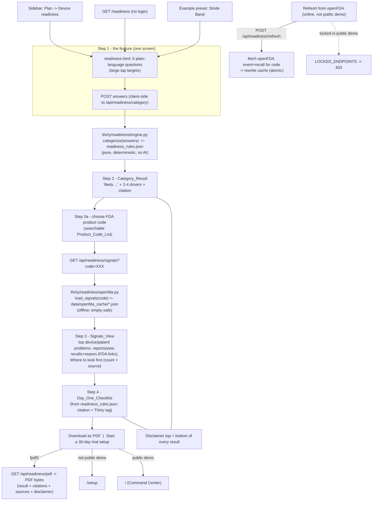

# Design Document

## Overview

The **device-readiness** feature adds a public, no-login **Device readiness** page at `/readiness` to the Thirty / Vigil console. A wellness or wearable company answers six plain-language questions about a health feature and gets, in one flow: (1) a deterministic likely-category verdict (general wellness / borderline / device Class I / II / III) with the two-to-four answers that drove it; (2) patterns from public openFDA MAUDE and recall data for a chosen FDA product code, served from an on-disk cache so it works offline and in the public demo; and (3) a day-one obligations checklist with citations, tagging which obligations Thirty itself handles. The page ends with a PDF download, a "start setup" link, and a disclaimer at the top and bottom of the result.

### Core stance: decision support, deterministic, cited

The category logic is a **pure, deterministic, data-driven function** — no agent and no model decide the outcome. Rules live in a data file (`thirty/readiness_rules.json`), not in templates or Python control flow. Every rendered result is phrased with "likely", shows at least one citation, and carries the exact disclaimer directing the user to confirm with a regulatory professional or ask FDA via a 513(g) request or a Q-Submission. The feature cites only the sources in the requirements' **Citation Catalogue**; it never invents regulations, guidance names, dates, or URLs. The openFDA step uses real public data (allowed), but presents counts as "where to look first", never as failure rates.

### How it fits the existing architecture

Grounded in reads of `dashboard_v2/app.py`, `dashboard_v2/templates/base.html`, `thirty/config.py`, `thirty/sample_data.py`, `vigil.py`, and `thirty/reporter/interview.py`:

- **Console route + template, like every other page.** The page is a plain `@app.route("/readiness")` returning `render_template("readiness.html", page="readiness", title="Device readiness")`, exactly as `home`/`complaints`/`trends` do. Data is fetched from small `/api/readiness/...` JSON endpoints the page polls/calls, matching the console's `/api/...` convention. The sidebar gains a new group `("Plan", [("readiness", "/readiness", "Device readiness", "<icon>")])` in `NAV_GROUPS`; `base.html` renders it from that data with no template logic change (Requirement 1.2).
- **Pure logic in the `thirty` package, mirroring `thirty/reporter/interview.py`.** The category engine and the openFDA cache loader are pure, import-light modules under `thirty/readiness/`, so the Hypothesis property tests drive them without Flask — the same split the reporter front door uses (pure reducers in `interview.py`, Flask only in the route).
- **Rules as data.** `thirty/readiness_rules.json` is loaded once and cached; the engine reads thresholds, driver phrasings, category labels, the product-code list, the day-one checklist, and the citation catalogue from it (Requirements 3.1, 11.1–11.3).
- **openFDA cache as flat JSON, offline-first.** One JSON file per product code per API under `data/openfda_cache/`, each recording the query URL and fetch date, written with the repo's atomic `tmp` + `os.replace` convention. The page never calls the network on render (Requirement 6.1); a "Refresh from openFDA" endpoint updates the cache when online, and is locked in the public demo via the existing `PUBLIC_DEMO` / `LOCKED_ENDPOINTS` mechanism.
- **PDF via `fpdf2`, mirroring `vigil.render_mdr_pdf`.** Same import guard (`FPDF is None` → graceful degrade), same bundled-DejaVu font setup, same table/section helpers.
- **100% local and offline in the demo.** No CDNs, no third-party services on the render path. The public demo seeds sample data on start and renders every selectable product code from the cache.

### Key grounding facts (verified in the codebase and against FDA sources)

- `NAV_GROUPS` (`dashboard_v2/app.py` ~701) is `[(GroupLabel, [(key, href, label, icon_name), ...]), ...]`; `base.html` (~309) renders it; `_globals()` (~734) injects `NAV_GROUPS`, `DEMO_MODE`, `PUBLIC_DEMO`, `PUBLIC_BASE`, `icon`, `TODAY`, etc. The `icon_name` must exist in the `ICONS` dict or `icon()` returns empty markup.
- `config.public_demo()` is wired: `PUBLIC_DEMO` (app.py ~29), `_public_demo_lock()` before-request (~754) returns `_locked()` (JSON 403) for any `request.endpoint in LOCKED_ENDPOINTS` (~745). The refresh endpoint is added to `LOCKED_ENDPOINTS` so it is read-only in the demo (Requirement 6.5).
- `config.data_dir()` resolves the data folder (`VIGIL_DIR`, else repo root, else app-data). The openFDA cache lives under `data_dir()/openfda_cache/`.
- The eight sample product codes (`thirty/sample_data.py` `DEVICES`): BZD (CPAP), FRN (Infusion pump), QBJ (Continuous glucose monitor), DWJ (Patient warming system), MWI (Patient monitor), NOU (Home ventilator), DQA (Pulse oximeter), FLE (Steam sterilizer). `MAKER = "Northwind Medical"` (invented).
- `vigil.render_mdr_pdf` (~402) is the live fpdf2 pattern: `FPDF is None` guard, `FONT_DIR` → bundled `thirty/fonts/DejaVuSans*.ttf`, `pdf.add_font("DejaVu", ...)`, `pdf.table(...)` with `FontFace`, `pdf.output(path)`.
- openFDA endpoints (verified): device adverse events `https://api.fda.gov/device/event.json` (count over `device.device_problem_text` / problem codes and `patient.patient_problems`; `date_received` for per-year); device recalls `https://api.fda.gov/device/recall.json` (fields include `reason_for_recall`, `product_code`, `cfres_id` for the FDA record link). openFDA `count=<field>.exact` returns term/count buckets; `limit` ≤ 1000. Requires no API key.
- QMSR (21 CFR 820) is in effect since **2 February 2026** (verified at fda.gov).
- `hypothesis` and `pytest` are installed; `tests/conftest.py` forces `THIRTY_AGENT=sample`, `THIRTY_SAMPLE_DELAY=0`, a temp `VIGIL_DIR`, and provides `data_dir` / `console` / `client` fixtures. `tests/test_claude_agent.py` shows the Hypothesis `@settings(max_examples=100)` + `@given(...)` pattern to mirror.

### Build sequencing

Implementation (code and tests) begins **only after the public-demo spec is finished**. This design and the requirements may be written now. The task list below is ordered so that all pure logic, data, and tests come first and the only shared-file edits (`NAV_GROUPS`, one `/readiness` route block, one template) are small, additive, and clearly named, to avoid colliding with concurrent template work.

## Architecture



The engine is the only thing that decides a category, and it is pure and total: for every answer combination it returns exactly one result. The page owns rendering and the step flow; the openFDA module owns the cache and is empty-safe; the PDF and refresh are thin wrappers.

## Components and Interfaces

### 1. Category engine — `thirty/readiness/engine.py` (pure)

A new package `thirty/readiness/` (sibling to `thirty/reporter/`) with `engine.py` holding the deterministic category logic. Import-light and Flask-free so property tests drive it directly (mirrors `thirty/reporter/interview.py`).

**Canonical answer model.** A normalized dict, the sole input to the engine:

```python
# thirty/readiness/engine.py
CLAIM_OPTIONS = ("wellness", "measure", "flag", "diagnose", "treat", "replace")
WORST_OUTCOMES = ("none", "minor", "serious", "death")
USERS = ("consumers", "clinicians", "both")
PREDICATE = ("yes", "no", "unsure")
CATEGORIES = ("general_wellness", "borderline", "class_i", "class_ii", "class_iii")

Answers = {
    "claims": set[str],       # subset of CLAIM_OPTIONS (Q1, choose all)
    "invasive": bool,         # Q2 yes/no
    "disease_claim": bool,    # Q3 yes/no
    "worst": str,             # Q4, one of WORST_OUTCOMES
    "users": str,             # Q5, one of USERS
    "predicate": str,         # Q6, one of PREDICATE
}
```

**Public functions:**

```python
def load_rules() -> dict
    # Read + cache thirty/readiness_rules.json (cached by file mtime, like
    # history_context()/plugins caching). Returns the parsed rules dict.

def normalize(raw) -> Answers
    # Coerce raw form/JSON input into the Answers shape: unknown claims dropped,
    # missing booleans default False, out-of-set scalars default to the safest
    # value (worst->"none", users->"consumers", predicate->"unsure"). Total:
    # never raises on arbitrary input (needed for the property tests and R2.10
    # handling upstream).

def categorize(answers) -> Result
    # The deterministic decision. Pure, total, reads thresholds from load_rules().
    # Returns exactly one Result for any Answers (Property 1).
```

**Result shape** (what the template and PDF render):

```python
Result = {
    "category": "borderline",                 # one of CATEGORIES
    "label": "Borderline",                    # human label from rules
    "headline": "Likely ...",                 # always contains "likely"
    "drivers": [ "Estimates a body measurement (blood pressure)", ... ],  # 2-4 items
    "paths": [ {"name": "510(k)", "when": "..."}, ... ],  # for class_ii / borderline dual paths
    "citations": [ {"key": "cds_guidance", "label": "...", "date": "January 2026", "url": None}, ... ],  # >= 1
    "suggested_product_code": "QBJ",          # closest code for Step 3 default (may be None)
    "disclaimer": DISCLAIMER,                 # the exact sentence
}
```

**Decision procedure (deterministic order; encodes Requirement 3.4–3.9).** Evaluated top to bottom; the first matching rule wins, guaranteeing exactly one result:

1. **Device triggers** → `device = any(c in {"diagnose","treat","replace"} for c in claims) or invasive or disease_claim`. (Requirement 3.4: when `device` is true the result is never `general_wellness`.)
2. If **not** `device`:
   - If `claims == {"wellness"}` and not `invasive` and not `disease_claim` and `worst in {"none","minor"}` → **`general_wellness`** (R3.5).
   - Else if `"measure" in claims` and `claims` has no `{"flag","diagnose","treat","replace"}` and not `invasive` and not `disease_claim` → **`borderline`** with both paths shown (R3.6).
   - Else → **`borderline`** (a non-wellness, non-measure, non-device combination — e.g. only `measure`+wellness is covered above; any remaining case that is not a device and not pure wellness is borderline by construction). This keeps the function total without ever returning wellness for a triggered feature.
3. If `device`:
   - If `worst == "death"` **or** (`invasive` and `worst == "serious"`) → **`class_iii`** (R3.7).
   - Else if `worst == "serious"` **or** `"flag" in claims` → **`class_ii`**; attach paths from `predicate`: `yes`→510(k), `no`→De Novo, `unsure`→both (R3.8).
   - Else if `worst == "minor"` and not `invasive` → **`class_i`** with the "many Class I are 510(k)-exempt; check the classification regulation" note (R3.9).
   - Else (device but `worst == "none"`, non-invasive, no flag) → **`class_i`** (lowest device class; `death` is handled above so Class I never results from `death`, Property 3). This branch keeps the device path total.

Drivers are derived from the two-to-four answers that actually fired the matched rule (e.g. the `diagnose` claim, `invasive=yes`, `worst=death`), phrased from a `driver_text` table in the rules file (R3.3). Citations always include at least the relevant guidance/regulation key (R3.11, Property 4): `general_wellness`/`borderline` cite `gw_guidance` (+ `cds_guidance` when a `measure`/`flag` nuance applies); device categories cite the relevant pathway and `reg_803` is always added by the checklist (Property 5).

**Why this encodes the rules safely:** the ordering puts the strongest device signal (death / invasive-serious → Class III) first, so no weaker rule can override it; `general_wellness` is reachable only in the single explicit non-device branch, so Property 2 (never wellness on a trigger) holds by construction; and every branch returns a category, so Property 1 (exactly one) holds.

### 2. Rules data file — `thirty/readiness_rules.json` (R11)

A single JSON document the engine reads. It is **data**, reviewable without touching code or templates. Shape:

```jsonc
{
  "categories": {
    "general_wellness": {"label": "Likely general wellness (not a device)", "headline": "..."},
    "borderline":       {"label": "Borderline", "headline": "..."},
    "class_i":          {"label": "Likely device: Class I", "headline": "..."},
    "class_ii":         {"label": "Likely device: Class II, 510(k) if a predicate exists, otherwise De Novo", "headline": "..."},
    "class_iii":        {"label": "Likely device: Class III, PMA", "headline": "..."}
  },
  "driver_text": {
    "claim.diagnose": "Claims to diagnose a disease",
    "claim.measure":  "Estimates a body measurement",
    "invasive":       "Invasive, implanted, or delivers energy/substance into the body",
    "disease_claim":  "Marketing names a specific disease or condition",
    "worst.death":    "Worst realistic outcome is death",
    "worst.serious":  "Worst realistic outcome is serious injury",
    "...": "..."
  },
  "paths": {
    "510k":   {"name": "510(k)", "when": "a cleared predicate device exists"},
    "denovo": {"name": "De Novo", "when": "no cleared predicate exists"},
    "borderline_wellness": {"name": "May be general wellness", "when": "presented as wellness information, no disease claim, no diagnostic use (January 2026 guidance)"},
    "borderline_device":   {"name": "Otherwise a device", "when": "presented or used for a disease or diagnosis"}
  },
  "citations": {
    "gw_guidance":  {"label": "FDA guidance \"General Wellness: Policy for Low Risk Devices\" (updated January 2026)", "date": "January 2026", "url": null},
    "cds_guidance": {"label": "FDA guidance \"Clinical Decision Support Software\" (updated January 2026)", "date": "January 2026", "url": null},
    "reg_807":  {"label": "21 CFR Part 807 (establishment registration and device listing)", "url": null},
    "reg_820_qmsr": {"label": "21 CFR Part 820, Quality Management System Regulation (QMSR), aligned with ISO 13485", "date": "in effect since 2 February 2026", "url": null},
    "reg_803":  {"label": "21 CFR Part 803 (Medical Device Reporting)", "url": null},
    "reg_806":  {"label": "21 CFR Part 806 (reports of corrections and removals)", "url": null},
    "reg_830":  {"label": "21 CFR Part 830 (Unique Device Identification)", "url": null},
    "reg_801":  {"label": "21 CFR Part 801 (device labeling)", "url": null},
    "fdc_524b": {"label": "FD&C Act section 524B (cybersecurity for cyber devices)", "url": null},
    "path_513g": {"label": "513(g) Request for Information", "url": null},
    "path_qsub": {"label": "Q-Submission", "url": null},
    "openfda_event":  {"label": "openFDA device adverse-event API", "url": "https://api.fda.gov/device/event.json"},
    "openfda_recall": {"label": "openFDA device recall API", "url": "https://api.fda.gov/device/recall.json"}
  },
  "day_one_checklist": [
    {"id": "registration", "text": "Establishment registration and device listing", "citations": ["reg_807"], "thirty": null},
    {"id": "qmsr",         "text": "Quality management system: QMSR aligned with ISO 13485", "citations": ["reg_820_qmsr"], "thirty": null},
    {"id": "complaints",   "text": "Complaint handling and complaint files", "citations": ["reg_820_qmsr"], "thirty": "handles"},
    {"id": "mdr",          "text": "Medical Device Reporting: deaths, serious injuries and malfunctions within 30 calendar days, 5 work days when remedial action is needed", "citations": ["reg_803"], "thirty": "handles"},
    {"id": "corrections",  "text": "Reports of corrections and removals within 10 working days", "citations": ["reg_806"], "thirty": "flags"},
    {"id": "udi",          "text": "Unique Device Identification and labeling", "citations": ["reg_830", "reg_801"], "thirty": null},
    {"id": "cyber",        "text": "Cybersecurity requirements for connected cyber devices", "citations": ["fdc_524b"], "thirty": null},
    {"id": "audit",        "text": "Audit trail of who decided what and when", "citations": [], "thirty": "handles"}
  ],
  "product_codes": [
    {"code": "BZD", "label": "CPAP (sample device)"},
    {"code": "FRN", "label": "Infusion pump (sample device)"},
    {"code": "QBJ", "label": "Continuous glucose monitor (sample device)"},
    {"code": "DWJ", "label": "Patient warming system (sample device)"},
    {"code": "MWI", "label": "Patient monitor (sample device)"},
    {"code": "NOU", "label": "Home ventilator (sample device)"},
    {"code": "DQA", "label": "Pulse oximeter (sample device)"},
    {"code": "FLE", "label": "Steam sterilizer (sample device)"}
    // Extra common wearable/monitor codes are appended ONLY after being
    // confirmed to return openFDA results during the build (see below).
  ],
  "example_preset": {
    "name": "Stride Band",
    "note": "invented wellness wearable with a blood-pressure trend feature",
    "answers": {"claims": ["wellness", "measure"], "invasive": false, "disease_claim": false,
                "worst": "minor", "users": "consumers", "predicate": "unsure"}
  },
  "disclaimer": "Decision support only, not regulatory advice. Confirm with a regulatory professional or ask FDA (513(g) request or Q-Submission).",
  "incomplete_data_notice": "Patterns from public FDA reports for similar devices. Reports are incomplete and have no usage denominator, so counts are not failure rates. Use this to decide where to look first, not to predict your device's faults."
}
```

The checklist always contains the `mdr` item citing `reg_803` (Property 5). The day-one tags are fixed in data: `handles` on `complaints`, `mdr`, `audit`; `flags` on `corrections`; none on the rest (R7.2–7.4). The `example_preset.answers` are chosen so `categorize(normalize(answers))` returns `borderline` — a `measure` claim with no device trigger (R10.2); this invariant is asserted by a test.

**Extra wearable product codes — confirmed, never guessed.** The `product_codes` list ships with the 8 sample codes. During the build, candidate common wearable/monitor codes (e.g. photoplethysmograph pulse-rate, electrocardiograph software) are **each confirmed via the openFDA fetch MCP tool** before inclusion: a candidate code is added only if a `count` query to `device/event.json` for that `product_code` returns results and a cache file is produced. Any candidate that returns no results is omitted; if none are confirmed, the list stays at the 8 sample codes. Every entry in `product_codes` therefore has a cache file (Requirement 4.5, 4.1). This is a build-time data-population step, not runtime behaviour.

### 3. openFDA cache + loader — `thirty/readiness/openfda.py` (R5, R6)

Pure, import-light loader plus a thin network fetcher used only by refresh/build.

**Cache layout** under `config.data_dir()/openfda_cache/`:

```
openfda_cache/
  BZD_event.json      # {"url": "...", "fetched": "2026-10-24", "data": <openFDA count/meta payload>}
  BZD_recall.json     # {"url": "...", "fetched": "2026-10-24", "data": <openFDA recall payload>}
  QBJ_event.json
  ...
```

Each file records the query URL and fetch date (Requirement 6.2). The payload stores exactly the three summaries the view needs, pre-reduced so the loader does no heavy work on render:

```python
# BZD_event.json "data":
{
  "device_problems":  [{"term": "Material Fragmentation / Particles", "count": 812}, ...],  # top N
  "patient_problems": [{"term": "No Clinical Signs ...", "count": 1032}, ...],              # top N
  "reports_per_year": [{"year": 2023, "count": 1200}, {"year": 2024, "count": 1500}, ...]   # last 3y
}
# BZD_recall.json "data":
{
  "recalls": [{"reason": "Firmware may ...", "date": "2025-03-11", "cfres_id": "...",
               "url": "https://api.fda.gov/device/recall.json?search=cfres_id:..."}, ...]
}
```

**Loader interface (pure, empty-safe):**

```python
def cache_dir() -> str                      # config.data_dir() + "/openfda_cache"; created lazily
def load_signals(product_code) -> dict
    # Read <CODE>_event.json and <CODE>_recall.json. Missing file, empty file,
    # invalid JSON, or zero records -> a well-formed EMPTY result, never raises
    # (Requirement 6.7, Property 6). Shape:
    # {"code": "BZD", "device_problems": [...], "patient_problems": [...],
    #  "reports_per_year": [...], "recalls": [...],
    #  "fetched": {"event": "2026-10-24"|None, "recall": ...|None},
    #  "has_data": bool}
def where_to_look_first(signals, answers) -> list
    # Map openFDA patterns to the Step 1 answers. For a "measure" claim, surface
    # device problems whose term matches an accuracy/false-reading pattern; for a
    # connected feature, surface software/connectivity problems. Each returned
    # item carries {"label", "count", "source"} so the view always shows the
    # count and the source (Requirement 5.5, Property 7). Returns [] when there
    # is no data (the view then shows the empty state).
```

`where_to_look_first` matches on a small keyword table in the rules file (`"accuracy_terms"`, `"connectivity_terms"`) against the cached `device_problems` terms; `source` is the citation label `openfda_event` / `openfda_recall`. "Connected feature" is inferred from the answers (a `measure`/`flag` feature with consumer/both users and a product family that is a monitor/wearable); the exact flag is read from the normalized answers plus the product code.

**Network fetcher (refresh/build only, never on render):**

```python
def fetch_and_cache(product_code, *, timeout=20) -> dict
    # Build the event + recall query URLs, GET via `requests` (already a dep),
    # reduce to the stored payload, write each file atomically (tmp + os.replace,
    # the repo convention). Returns the new load_signals(code) result.
    # Query URLs:
    #   https://api.fda.gov/device/event.json?search=device.openfda.product_code:"CODE"
    #       +AND+date_received:[<3y-ago>+TO+<today>]&count=device.device_problem_text.exact
    #   (a second count query for patient.patient_problems.exact; a third for
    #    date_received year buckets)
    #   https://api.fda.gov/device/recall.json?search=product_code:"CODE"&limit=10&sort=event_date_posted:desc
    # On any HTTP error / timeout / parse failure: raise RefreshError; callers
    # keep the existing cache and report "refresh did not complete" (R6.6).
```

The build step calls `fetch_and_cache` for every code (using the fetch MCP tool to perform the actual retrieval and confirm codes, then saving the reduced JSON); refresh calls it for one code. Render only ever calls `load_signals`.

### 4. PDF builder — `thirty/readiness/pdf.py` (R9.1–9.3)

Mirrors `vigil.render_mdr_pdf`'s fpdf2 setup. Guarded import so absence of `fpdf2` degrades gracefully.

```python
try:
    from fpdf import FPDF
    from fpdf.enums import XPos, YPos
    from fpdf.fonts import FontFace
except Exception:
    FPDF = None

def available() -> bool          # FPDF is not None
def build_pdf(result, signals, checklist, *, product_code) -> bytes | None
    # None when FPDF is None (caller hides/disables the button, R9.3).
    # Sections: title; the Disclaimer (top); Category_Result headline + drivers +
    # paths; Signals_View summary (product code, top problems, reports/year,
    # recalls + reasons) with the incomplete-data notice; Day_One_Checklist with
    # citations and Thirty tags; "Sources" block listing every citation label +
    # URL used and the openFDA query URLs/fetch dates from the cache; the
    # Disclaimer again (bottom). DejaVu fonts from thirty/fonts, Helvetica fallback.
```

`build_pdf` renders strictly from the engine `result`, the loaded `signals`, and the rules' `day_one_checklist` — so the PDF's citations and sources are exactly those shown on the page (R9.2) and nothing new is invented.

### 5. Routes — in `dashboard_v2/app.py` (one small, additive block)

All no-auth, matching the console's route style. A single contiguous block keeps the shared-file edit small and reviewable.

| Method & path | Purpose | Requirements |
|---|---|---|
| `GET /readiness` | Render `readiness.html` (page shell: the four steps, example preset, disclaimer top/bottom) | 1.1, 1.3, 1.5, 1.6, 8.1, 8.2 |
| `POST /api/readiness/category` | `categorize(normalize(json))` → `Result` JSON (used by Step 1 → Step 2) | 2.9, 2.10, 3.* |
| `GET /api/readiness/signals?code=XXX` | `load_signals(code)` + `where_to_look_first(...)` → JSON | 4.4, 5.*, 6.1, 6.7 |
| `POST /api/readiness/refresh` | Online + not public demo: `fetch_and_cache(code)`; **in `LOCKED_ENDPOINTS`** so the demo returns 403 | 6.4, 6.5, 6.6 |
| `GET /api/readiness/pdf` | Rebuild result+signals from submitted answers, `build_pdf(...)`, return `application/pdf`; 404/empty if `fpdf2` missing | 9.1–9.3 |

The engine runs server-side (never client-side) so the rules file is the single source of truth. The template calls `/api/readiness/category` and `/api/readiness/signals` with `fetch()` and renders the returned JSON (same pattern as `/api/state`, `/api/trends`). `api_readiness_refresh` is added to the `LOCKED_ENDPOINTS` set (app.py ~745) so `_public_demo_lock()` returns 403 in the public demo (R6.5), and the button is rendered disabled when `PUBLIC_DEMO` (R6.5 UI).

**Start-setup action (R9.4–9.6):** the template renders the "Start a 30-day trial setup" button's `href` as `"/" if PUBLIC_DEMO else "/setup"` using the injected `PUBLIC_DEMO` global — `/setup` normally (first-run setup), the Command Center in the public demo.

### 6. Navigation + template

- **Sidebar (R1.2):** add `("Plan", [("readiness", "/readiness", "Device readiness", "shield")])` to `NAV_GROUPS`. The icon key must exist in `ICONS`; if a suitable one (e.g. a shield/clipboard) is not already present, add one SVG entry to the `ICONS` dict in the same block. Position the "Plan" group between "Work" and "Records" (or per brand preference) — purely the tuple's list position.
- **Template `dashboard_v2/templates/readiness.html`:** extends `base.html`, fills ``. Self-contained so it does not collide with concurrent template work. Contains:
  - the Step 1 question screen (large 44×44 controls via a small scoped CSS block in ``, mirroring how pages add page CSS);
  - the example-preset button (fills the Step 1 controls from `example_preset` via a tiny inline script, no framework);
  - result, signals, checklist regions populated from the `/api/readiness/*` JSON;
  - the disclaimer rendered **top and bottom** of the result region (R8.1, 8.2);
  - the "Download as PDF", "Refresh from openFDA" (disabled when `PUBLIC_DEMO`), and "Start a 30-day trial setup" buttons.
  Brand usage follows the steering: coral reserved for the single key action (e.g. "Start a 30-day trial setup"); amber only for NEEDS-INFO-style emphasis; "likely" phrasing and the incomplete-data notice shown verbatim.

## Data Models

### Answers (engine input)

`{claims: set[str] ⊆ CLAIM_OPTIONS, invasive: bool, disease_claim: bool, worst ∈ WORST_OUTCOMES, users ∈ USERS, predicate ∈ PREDICATE}`. `normalize()` is total: arbitrary raw input is coerced into this shape (unknown claims dropped; missing booleans → False; out-of-set scalars → safest default). Totality of `normalize` + totality of `categorize` gives Property 1 over all raw inputs.

### Result (engine output → template, PDF)

See the Result shape above: `{category, label, headline("likely"), drivers[2..4], paths[], citations[>=1], suggested_product_code, disclaimer}`.

### Signals (openFDA cache → view, PDF)

`load_signals(code)` → `{code, device_problems[], patient_problems[], reports_per_year[], recalls[], fetched{event,recall}, has_data}`. Each `device_problems`/`patient_problems` item is `{term, count}`; each `recalls` item is `{reason, date, cfres_id, url}`; `reports_per_year` item is `{year, count}`. Empty/missing → all lists empty, `has_data=False`.

### Where-to-look-first item

`{label, count, source}` — never shown without both `count` and `source` (Property 7).

### openFDA cache file

`{url: str, fetched: "YYYY-MM-DD", data: {...}}` — one per `<CODE>_event.json` / `<CODE>_recall.json`, written atomically (tmp + `os.replace`).

## Error Handling

| Condition | Handling | Requirement |
|---|---|---|
| Step 1 submitted with no claim selected | Engine not run; page prompts "select at least one claim"; no result rendered | 2.10 |
| Arbitrary / malformed answer JSON | `normalize()` coerces to the safe default shape; `categorize()` still returns exactly one result | 2.10, 3.10 |
| Cache file missing / empty / invalid JSON / zero records | `load_signals` returns the empty result (no raise); view shows "no data available" for the section and still shows the incomplete-data notice | 5.7, 6.7, Property 6 |
| openFDA count returns word-split noise | Queries use `count=<field>.exact`; loader stores pre-reduced buckets so the view never counts word fragments | 5.1 |
| Refresh while offline / HTTP error / timeout | `fetch_and_cache` raises `RefreshError`; route keeps the existing cache unchanged and returns a "refresh did not complete" message | 6.6 |
| Refresh in public demo | `api_readiness_refresh` in `LOCKED_ENDPOINTS` → `_locked()` 403; button rendered disabled | 6.5 |
| `fpdf2` not installed | `pdf.available()` False; PDF route returns 404/empty and the template hides/disables the "Download as PDF" button | 9.3 |
| Unknown product code requested | `load_signals` empty result + "no data available"; the Product_Code_List only offers cached codes so this is not normally reachable | 4.5, 5.7 |
| A citation key not in the catalogue | Not possible: the engine/checklist only reference keys present in `readiness_rules.json`'s `citations`; a test asserts every referenced key resolves | 7.6, 8.3 |

## Correctness Properties

*A property is a characteristic or behavior that should hold true across all valid executions of a system — a formal statement about what the system should do, bridging human-readable specifications and machine-verifiable guarantees.*

### Property 1: Exactly one category

For all `(claims, invasive, disease_claim, worst, users, predicate)`, `categorize(normalize(raw))` returns exactly one `category ∈ CATEGORIES`. The decision procedure is a total, first-match-wins ladder in which every branch returns a category.

**Validates: Requirements 3.10, 12.1**

### Property 2: Never general wellness when a device trigger is present

For all combinations where any of `diagnose`/`treat`/`replace` ∈ claims, or `invasive` is true, or `disease_claim` is true, the result `category` is not `general_wellness`. `general_wellness` is reachable only from the single non-device branch, so a trigger forecloses it by construction.

**Validates: Requirements 3.4, 12.2**

### Property 3: Death is never Class I

For all combinations with `worst == "death"`, the result `category` is not `class_i`. The `death` case is matched to `class_iii` before any Class I branch is reached.

**Validates: Requirements 3.9, 12.3**

### Property 4: Every result carries the disclaimer and a citation

For all combinations, the `Result` includes the exact `disclaimer` sentence and `len(citations) >= 1` drawn from the rules' citation catalogue.

**Validates: Requirements 3.11, 8.1, 8.3, 12.4**

### Property 5: The checklist always includes 21 CFR 803

For all combinations, the Day_One_Checklist rendered with the result contains the Medical Device Reporting item whose citation is `reg_803`.

**Validates: Requirements 7.1, 7.5, 12.5**

### Property 6: Empty cache is safe and visible

For any product code whose `<CODE>_event.json` / `<CODE>_recall.json` is missing, empty, invalid, or has zero records, `load_signals` returns the empty result without raising, and the Signals_View renders "no data available" while still showing the incomplete-data notice.

**Validates: Requirements 5.7, 6.7, 12.6**

### Property 7: Every where-to-look-first item shows a count and a source

For every item returned by `where_to_look_first` (hence every item the panel renders), the item has a numeric `count` and a non-empty `source`.

**Validates: Requirements 5.5, 12.7**

## Testing Strategy

Tests go under `tests/`, reusing `conftest.py` fixtures (`data_dir`, `console`, `client`) which already force the sample agent, zero delays, and a temp `VIGIL_DIR`. Everything runs offline; openFDA is never contacted in tests (the cache is seeded in the temp data dir, and refresh is tested with a patched `requests`).

### Property-based tests (Hypothesis) — `tests/test_readiness_properties.py`

Mirror the `@settings(max_examples=100)` + `@given(...)` style from `tests/test_claude_agent.py`. Strategies cover the full answer cross-product:

```python
claims   = st.sets(st.sampled_from(CLAIM_OPTIONS))          # every subset, incl. empty
invasive = st.booleans()
disease  = st.booleans()
worst    = st.sampled_from(WORST_OUTCOMES)
users    = st.sampled_from(USERS)
predicate= st.sampled_from(PREDICATE)
```

- **P1 — exactly one category.** For every generated tuple, `categorize(normalize(...))["category"]` is in `CATEGORIES` and the function returns a single result (no exception, no `None`). Also feed deliberately malformed raw dicts (`st.dictionaries(st.text(), st.text())`) through `normalize` → `categorize` to prove totality (R2.10/3.10).
- **P2 — never wellness on a trigger.** Restrict to tuples with at least one trigger (`assume(...)` or a trigger-biased strategy); assert `category != "general_wellness"`.
- **P3 — death is never Class I.** Fix `worst="death"`; assert `category != "class_i"`.
- **P4 — disclaimer + citation.** For every tuple, assert `result["disclaimer"] == DISCLAIMER` and `len(result["citations"]) >= 1`, and that every citation key resolves in the rules catalogue.
- **P5 — always 803.** For every tuple, build the checklist and assert an item with citation `reg_803` is present.

Each property test is tagged `# Feature: device-readiness, Property N: <text>`.

### Example-based tests — `tests/test_readiness.py`

- **Rules file integrity:** `load_rules()` parses; every citation key referenced by categories, drivers, paths, and the checklist exists in `citations`; the checklist tags are exactly `handles` on `complaints`/`mdr`/`audit`, `flags` on `corrections`, none elsewhere (R7.2–7.4); `product_codes` is non-empty and each entry has a cache file available in the test fixture.
- **Named category cases:** pure-wellness non-invasive minor → `general_wellness` (R3.5); `measure` only, no disease → `borderline` with both paths (R3.6); device + `death` → `class_iii`; invasive + `serious` → `class_iii` (R3.7); device + `serious` with predicate yes/no/unsure → `class_ii` + 510(k)/De Novo/both (R3.8); device + `minor` non-invasive → `class_i` with the exemption note (R3.9); drivers count is 2–4 (R3.3).
- **Example preset:** `categorize(normalize(rules["example_preset"]["answers"]))` is `borderline` (R10.2); the preset references only invented names (R10.3).
- **openFDA loader (offline):** seed a temp `openfda_cache/` under `data_dir`; `load_signals` returns the stored buckets; a missing file, an empty file, and a zero-record file each return the empty result and set `has_data=False` (R6.7, Property 6); `where_to_look_first` items all carry `count` + `source` (Property 7); a `measure` feature surfaces accuracy/false-reading terms, a connected feature surfaces software/connectivity terms (R5.4).
- **Refresh (patched network):** monkeypatch `requests.get` (contextmanager pattern from `test_claude_agent.py`) to return canned openFDA JSON → `fetch_and_cache` writes the cache atomically and the file records `url` + `fetched`; a raising/timeout `requests.get` → `RefreshError`, existing cache untouched (R6.6).
- **Routes (Flask `client`):** `GET /readiness` returns 200 and contains the disclaimer twice (top and bottom) (R8.1, 8.2) and the "Plan"/"Device readiness" nav entry; `POST /api/readiness/category` returns the expected category for known answer sets; `GET /api/readiness/signals?code=BZD` returns the seeded signals; the start-setup button href is `/setup` normally and `/` when `PUBLIC_DEMO`; with `THIRTY_PUBLIC_DEMO=1`, `POST /api/readiness/refresh` returns 403 (R6.5).
- **PDF:** when `fpdf2` is present, `build_pdf(...)` returns non-empty bytes starting with `%PDF`; the PDF route returns `application/pdf`; the "Sources" section lists the citations and openFDA URLs used (R9.2). When `FPDF` is monkeypatched to `None`, `available()` is False and the route degrades (R9.3).
- **Signals wording:** the Signals_View always renders the exact incomplete-data notice, including in the empty-cache state (R5.6, 5.7).

**Why these test types.** The category decision and the invariants over it (one category, never-wellness, death-not-Class-I, disclaimer/citation, always-803) are universal over the full finite answer space, so they are property tests (and the space is small enough that Hypothesis effectively enumerates it). Cache loading, refresh, routing, PDF content, and exact on-screen wording are specific behaviours that do not vary over random inputs, so they are example-based.

## Build-sequencing and shared-file note

- **Do not start coding until the public-demo spec is finished.** This document and the requirements may be written now.
- **Do not edit `report_*` templates or routes.** This feature touches none of them.
- **Shared-file edits are minimized and additive:** one `NAV_GROUPS` tuple (+ at most one `ICONS` entry), one contiguous `/readiness` + `/api/readiness/*` route block, one new template `readiness.html`, and one `LOCKED_ENDPOINTS` addition. All new logic lives in the new `thirty/readiness/` package and `thirty/readiness_rules.json`, isolated from concurrent work.
- **Extra product codes are confirmed via the openFDA fetch MCP tool at build time**, never guessed; unconfirmed codes are omitted, falling back to the 8 sample codes.
