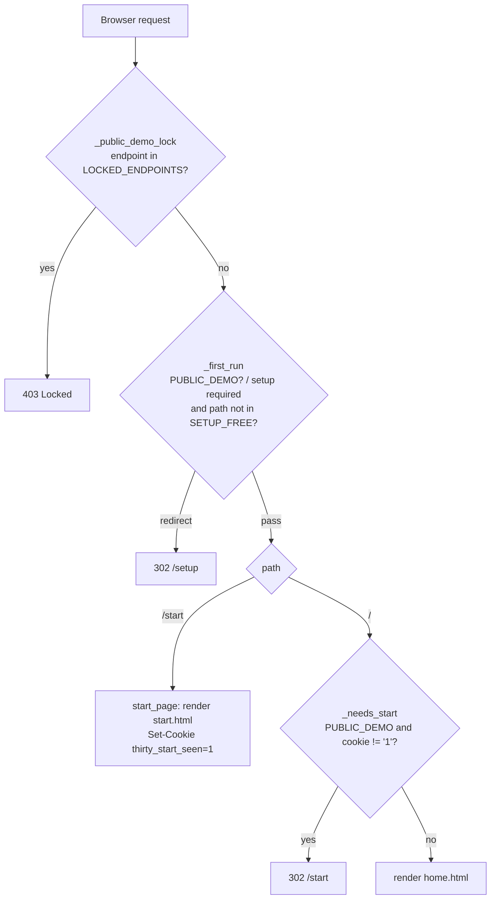

# Design Document: start-landing-page

## Overview

Add a public landing page at `GET /start` to the Flask console and, in the public demo only, send a browser's first `GET /` of the session to it. The change is small and local:

- `dashboard_v2/app.py`: one new route (`start_page`), one cookie constant, one pure helper (`_needs_start`), a two-line guard in `home()`, and `"/start"` added to `SETUP_FREE`. `LOCKED_ENDPOINTS` is unchanged.
- `dashboard_v2/templates/start.html`: new template. It extends `base.html`, exactly as `readiness.html` does, so it inherits `thirty.css`, the theme script, the ribbon background (`bg-fx`), the centred 1440px `.content` column and the public-demo banner.
- Tests: new `tests/test_start_page.py`; `tests/test_public_demo.py` gets its `pclient` fixture updated so existing `/` tests keep passing.

No new dependency, no new stylesheet, no JavaScript on the page, no data written to disk, no Flask session use.

### Key decisions

| Decision | Choice | Why |
|---|---|---|
| Template base | `` with `page_header` emptied | `readiness.html` (the style reference) extends `base.html`. Same chrome, tokens and `bg-fx` layer; one less place to keep in sync. |
| Ribbon background | Inherited from `base.html` (line 388), not repeated | `base.html` already renders `<div class="bg-fx" aria-hidden="true">…</div>`. A second copy would stack two fixed layers. |
| Headline font | Inline `@font-face` for "Instrument Serif" in the page `<style>` | `thirty.css` maps `--t-font-display` to Manrope and declares no Instrument Serif face, but `static/thirty/fonts/instrument-serif-400.woff2` ships. An inline rule keeps "no stylesheet beyond thirty.css". |
| First-visit tracking | Plain cookie `thirty_start_seen=1`, `Path=/`, no `Expires`/`Max-Age`, `SameSite=Lax`, `HttpOnly` | Browser-session lifetime; no JS reads it, so `HttpOnly`; `Lax` keeps it on top-level navigation. Not signed: it holds no secret and only steers one redirect. |
| Redirect status | `302` via `flask.redirect("/start")` | Temporary by nature; browsers do not cache a bare 302. |
| Cookie test | `request.cookies.get("thirty_start_seen") == "1"` | Any other value (or none) counts as "not seen". |
| Setup gate | Add `"/start"` to `SETUP_FREE` | `_first_run` uses `startswith`; matches how `/readiness` is exempted. |
| Demo lock | Leave `start_page` out of `LOCKED_ENDPOINTS` | It is a read-only GET. |

## Architecture



`/start` passes both `before_request` hooks in every mode: it is not a locked endpoint, and `/start` is in `SETUP_FREE` (outside the public demo `_first_run` already returns early).

## Components and Interfaces

### 1. `dashboard_v2/app.py`

Import `make_response` alongside the existing Flask imports:

```python
from flask import Flask, abort, jsonify, make_response, redirect, render_template, request, send_from_directory
```

Extend the setup-free tuple:

```python
SETUP_FREE = ("/setup", "/api/setup", "/api/plugins", "/api/health", "/static/", "/readiness", "/api/readiness", "/start")
```

Add, next to `home()`:

```python
# Public landing page. No login, open in the public demo (not in LOCKED_ENDPOINTS, path in SETUP_FREE).
# In the public demo the first GET / of a browser session goes here; a plain session cookie
# (not the Flask session) records that the visitor has seen it.
START_COOKIE = "thirty_start_seen"
REPO_URL = "https://github.com/jossefuggg/thirty"
SUBMISSION_URL = "https://github.com/jossefuggg/thirty/blob/hackachusetts/docs/hackachusetts/SUBMISSION.md"


def _needs_start(public_demo, cookies):
    """True when GET / should redirect to /start: public demo only, and the start cookie is not '1'."""
    return bool(public_demo) and cookies.get(START_COOKIE) != "1"


@app.route("/start")
def start_page():
    resp = make_response(render_template(
        "start.html", page="start", title="Start",
        repo_url=REPO_URL, submission_url=SUBMISSION_URL))
    # browser-session cookie: no max_age / expires
    resp.set_cookie(START_COOKIE, "1", path="/", samesite="Lax", httponly=True)
    return resp


@app.route("/")
def home():
    if _needs_start(PUBLIC_DEMO, request.cookies):
        return redirect("/start")
    return render_template("home.html", page="home", title="Command Center")
```

`home()` reads the module global `PUBLIC_DEMO` at request time, so tests can toggle it with `monkeypatch.setattr(console, "PUBLIC_DEMO", True)`.

### 2. `dashboard_v2/templates/start.html`

Skeleton (copy is final; class names prefixed `st-`):

```jinja

st-page
{# The hero is the page title; drop base.html's default header. #}


<style>
  @font-face { font-family: "Instrument Serif"; font-weight: 400; font-display: swap;
               src: url("/static/thirty/fonts/instrument-serif-400.woff2") format("woff2"); }
  .st-page { --st-gap: 20px; }
  .st-wrap { display: grid; gap: var(--st-gap); min-width: 0; }
  .glass { background: var(--t-glass-bg); -webkit-backdrop-filter: var(--t-glass-blur); backdrop-filter: var(--t-glass-blur);
           border: 1px solid var(--t-glass-border); border-radius: var(--t-radius-lg); box-shadow: var(--t-glass-shadow); }
  .st-hero { display: grid; grid-template-columns: minmax(0, 1fr) auto; gap: 28px; align-items: center; padding: 36px; }
  .st-eyebrow { font-weight: 800; font-size: 12px; letter-spacing: .18em; text-transform: uppercase; color: var(--t-blue-text); }
  .st-hero h1 { font-family: "Instrument Serif", Georgia, serif; font-weight: 400; font-size: clamp(40px, 7vw, 84px);
                line-height: 1; letter-spacing: -0.02em; margin: 10px 0 14px; color: var(--t-fg); }
  .st-hero p { font-size: 18px; line-height: 1.55; color: var(--t-fg-2); max-width: 640px; margin: 0; }
  .st-dial { width: 160px; height: 160px; object-fit: contain; }
  .st-doors { display: grid; grid-template-columns: repeat(3, minmax(0, 1fr)); gap: var(--st-gap); }
  .st-door { display: grid; align-content: start; gap: 10px; padding: 24px; min-width: 0; color: var(--t-fg);
             transition: border-color .15s ease, background-color .15s ease; }
  .st-door:hover { border-color: var(--t-fg-2); background: var(--t-panel); }
  .st-door:focus-visible { box-shadow: var(--t-focus); }
  .st-kicker { font-weight: 800; font-size: 11px; letter-spacing: .18em; text-transform: uppercase; color: var(--t-fg-2); }
  .st-door h2 { font-size: 24px; line-height: 1.15; letter-spacing: -0.02em; margin: 0; }
  .st-door p { font-size: 15px; color: var(--t-fg-2); margin: 0; }
  .st-go { justify-self: start; margin-top: 6px; }      /* rendered as .btn .btn-secondary, or .btn-accent on the one key door */
  .st-strip { display: flex; flex-wrap: wrap; gap: 6px 14px; justify-content: center; font-size: 13px; color: var(--t-fg-2); text-align: center; }
  .st-strip a { color: var(--t-fg); text-decoration: underline; text-underline-offset: 3px; }
  .st-page p, .st-page h1, .st-page h2 { overflow-wrap: anywhere; }
  @media (max-width: 980px) { .st-doors { grid-template-columns: minmax(0, 1fr); } }
  @media (max-width: 640px) {
    .st-hero { grid-template-columns: minmax(0, 1fr); padding: 20px 18px 22px; }
    .st-dial { width: 120px; height: 120px; order: -1; }
    .st-door { padding: 18px; }
  }
</style>


<div class="st-wrap">
  <header class="st-hero glass">
    <div>
      <span class="st-eyebrow">Thirty</span>
      <h1>Every complaint, on the clock.</h1>
      <p>Medical device complaint reporting: complete at the bedside, decided on time, approved by a named person.</p>
    </div>
    
  </header>

  <nav class="st-doors" aria-label="Where to start">
    <a class="st-door glass" href="/report">
      <span class="st-kicker">For nurses, patients and staff</span>
      <h2>Report a device problem</h2>
      <p>Describe what happened in your own words. Thirty asks follow-up questions until the report is complete. 4 languages.</p>
      <span class="st-go btn btn-accent">Start a report</span>
    </a>
    <a class="st-door glass" href="/">
      <span class="st-kicker">For the quality team</span>
      <h2>See what the quality team sees</h2>
      <p>The console: every complaint scored, a reportability decision and deadline drafted, Form 3500A ready for a named reviewer to approve.</p>
      <span class="st-go btn btn-secondary">Open the console</span>
    </a>
    <a class="st-door glass" href="/readiness">
      <span class="st-kicker">For product teams</span>
      <h2>Is your feature a medical device?</h2>
      <p>Answer a few questions about a health feature. See which FDA device rules may apply and what day one looks like. Rule-based, no AI.</p>
      <span class="st-go btn btn-secondary">Check readiness</span>
    </a>
  </nav>

  <p class="st-strip" role="note">
    <span>Public demo · invented sample data · nothing is sent to the FDA</span>
    <a href="{{ repo_url }}" target="_blank" rel="noopener">Code on GitHub</a>
    <a href="{{ submission_url }}" target="_blank" rel="noopener">How we built it with Kiro</a>
  </p>
</div>

```

Notes for the implementer:

- Each door is one `<a>` containing only non-interactive children (`<span>`, `<h2>`, `<p>`). The `.btn` inside is a styled `<span>`, not a nested link or button, so the whole card is a single link (Req 3.5).
- Coral appears once: `.btn-accent` on the "Report a device problem" door. No `--t-amber*` token appears in the template.
- Do not add a `bg-fx` div; `base.html` renders it.
- Copy avoids every "Never say" phrase (no "open source", no "submits to the FDA", no "fully automated").
- `page="start"` matches no `NAV_GROUPS` key, so no rail item is highlighted.

### 3. Tests

- **New `tests/test_start_page.py`** uses the existing `console` / `client` fixtures from `conftest.py` and toggles state with `monkeypatch.setattr(console, "PUBLIC_DEMO", ...)` and `monkeypatch.setattr(console.tsetup, "required", lambda: True)`.
- **Update `tests/test_public_demo.py`**: the `pclient` fixture sets the start cookie so `test_setup_is_skipped_and_data_seeded` and `test_banner_on_every_page` (both `GET /`) still get 200:

  ```python
  @pytest.fixture()
  def pclient(public_console):
      c = public_console.app.test_client()
      c.set_cookie("thirty_start_seen", "1")   # Werkzeug 3.x: (key, value, domain="localhost")
      return c
  ```

  Add one test there with a cookie-less client from the real public-demo import: `GET /` is 302 to `/start`, `GET /start` is 200 and sets the cookie, and the same client then gets 200 on `GET /`.
- `tests/test_setup.py` asserts `GET /` redirects to `/setup` when setup is required outside the public demo. That path is unchanged because `_needs_start` is false outside the public demo and `_first_run` runs before `home()`.
- `tools/screenshots.py` runs outside the public demo, so its `"/"` shots are unaffected.

## Data Models

The only state is one cookie. Nothing is written to `decisions.csv`, the audit trail, settings or the Flask session.

| Attribute | Value |
|---|---|
| Name | `thirty_start_seen` |
| Value | `1` |
| Path | `/` |
| Expires / Max-Age | not set (browser-session cookie) |
| SameSite | `Lax` |
| HttpOnly | yes |
| Signed | no |

Expected header: `Set-Cookie: thirty_start_seen=1; HttpOnly; Path=/; SameSite=Lax`.

## Error Handling

- **Template error**: `/start` has no data dependencies (no CSV, no agent, no network), so the only failure mode is a template bug, which the tests catch. The page needs only the `_globals()` context that every console page already uses.
- **Cookie disabled in the browser**: in the public demo `/` would redirect to `/start` every time. The visitor still reaches every door from `/start`, including the console card. Acceptable for a demo and documented here.
- **Odd cookie values** (`thirty_start_seen=0`, empty, garbage): treated as "not seen"; the visitor sees `/start` once more, which sets the value to `1`.
- **Redirect loop**: impossible. `/start` never redirects, and it sets the cookie that stops the `/` redirect.
- **Setup required (desktop / dev)**: `/start` renders; `/` still redirects to `/setup` as before.

## Correctness Properties

*A property is a characteristic or behavior that should hold true across all valid executions of a system: a formal statement about what the system should do. Properties bridge human-readable specifications and machine-verifiable correctness guarantees.*

Reflection on redundancy: 1.1, 1.2, 1.3, 1.4 and 6.1–6.3 all describe the response to `GET /start` and differ only in console state and incoming request, so they merge into Property 1. 7.1–7.3 are three cases of one decision over (`PUBLIC_DEMO`, cookie value), so they merge into Property 2. Page content (Req 2, 3, 4, 5.2, 5.5) is fixed markup and is covered by example tests.

### Property 1: The start page always renders and sets only the session start cookie

*For any* public-demo flag, any setup-required state, any set of incoming cookies (including `thirty_start_seen` with any value or absent) and any query string, `GET /start` returns HTTP 200 with the Start_Page HTML, and its `Set-Cookie` headers contain exactly one `thirty_start_seen=1` cookie with `Path=/` and no `Expires` or `Max-Age` attribute, and no cookie named `app.config["SESSION_COOKIE_NAME"]`.

**Validates: Requirements 1.1, 1.2, 1.3, 1.4, 6.1, 6.2, 6.3**

### Property 2: The console redirects to the start page only in the public demo without the cookie

*For any* public-demo flag and any start-cookie value (absent, `"1"`, or any other string), `GET /` responds with a redirect to `/start` if and only if the public-demo flag is true and the cookie value is not `"1"`; otherwise it renders the Console (HTTP 200, `home.html`). `_needs_start(public_demo, cookies)` returns the same boolean for the same inputs.

**Validates: Requirements 7.1, 7.2, 7.3**

## Testing Strategy

Property tests use Hypothesis (installed, 6.x) with `@settings(max_examples=100)`. Hypothesis rejects function-scoped pytest fixtures inside `@given`, so the property tests take the module-level `console` fixture and set `console.PUBLIC_DEMO` / `console.tsetup.required` inside the test body with `try/finally` restore (or `pytest.MonkeyPatch.context()`). Each example builds a fresh `console.app.test_client()` so cookies never leak between examples. Incoming cookies are sent as a raw `Cookie` header; generated cookie values use printable ASCII without `;`, `,`, `"`, `\` or whitespace.

Tag each property test with a comment:

- `# Feature: start-landing-page, Property 1: The start page always renders and sets only the session start cookie`
- `# Feature: start-landing-page, Property 2: The console redirects to the start page only in the public demo without the cookie`

### Example tests (`tests/test_start_page.py`)

| Test | Checks | Req |
|---|---|---|
| `test_start_200_normal` | `GET /start` is 200 with the public-demo flag off | 1.1, 8.1 |
| `test_start_200_public_demo` | `PUBLIC_DEMO=True`: `GET /start` is 200; `"start_page" not in LOCKED_ENDPOINTS` | 1.3, 8.2 |
| `test_start_bypasses_setup` | `tsetup.required -> True`: `/start` is 200, `/` is still 302 to `/setup` | 1.2 |
| `test_start_links` | HTML contains `href="/report"`, `href="/"`, `href="/readiness"` | 3.2–3.4, 8.3 |
| `test_start_hero_copy` | label "Thirty" before the `<h1>`, headline, sentence, dial `` with non-empty `alt`, Instrument Serif `@font-face` | 2.1–2.4 |
| `test_start_three_doors` | exactly 3 `class="st-door` anchors; titles and the "nurses, patients and staff" and "4 languages" text; no `<a` nested inside a door | 3.1–3.5 |
| `test_start_demo_strip` | strip text, Repo_URL link, "How we built it with Kiro" link to Submission_URL, both with `target="_blank"` and `rel="noopener"` | 4.1–4.4 |
| `test_start_style_rules` | exactly one `<link rel="stylesheet">` (`thirty.css`); one `bg-fx` with `aria-hidden="true"`; the template source has one `btn-accent` and no `amber` | 5.1, 5.2, 5.5 |
| `test_home_redirect_public_demo` | `PUBLIC_DEMO=True`: no cookie is 302 to `/start`; with cookie it is 200 | 7.1, 7.2, 8.4 |
| `test_home_normal_ignores_cookie` | `PUBLIC_DEMO=False`: 200 with and without the cookie | 7.3 |

Plus the round-trip test in `tests/test_public_demo.py` on the real public-demo import (described above).

### Layout checks (smoke)

Req 5.3 (1440px column) comes from `base.html` `.content`. Req 5.4 (single column at 390px, no horizontal scroll) is a layout check: verify by hand at 390px, or with Playwright (already in `requirements-dev.txt`) that `document.documentElement.scrollWidth <= innerWidth` at a 390×844 viewport. Optionally add `("start", "/start")` to `tools/screenshots.py`.

### Final gate

`pytest` reports zero failures (Req 8.5), including the updated `tests/test_public_demo.py`.
